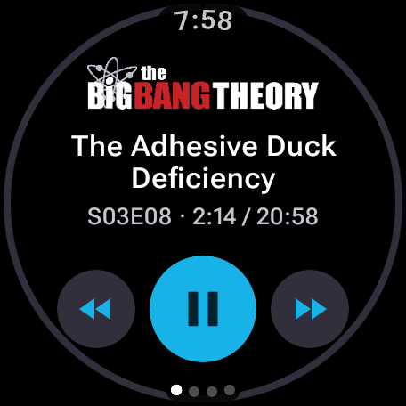
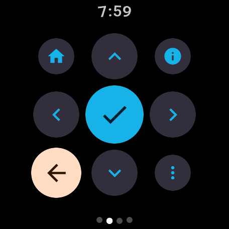
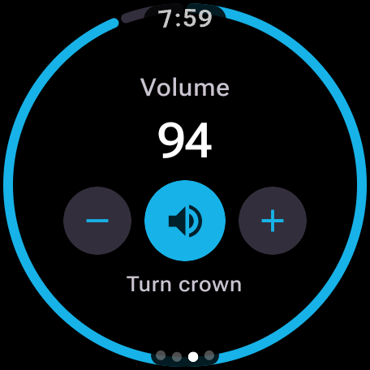
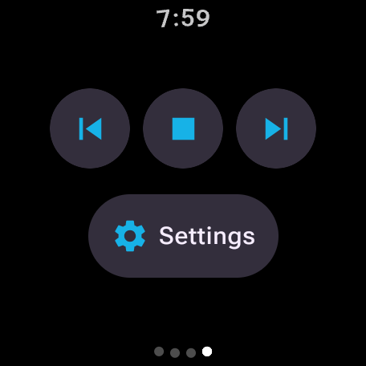
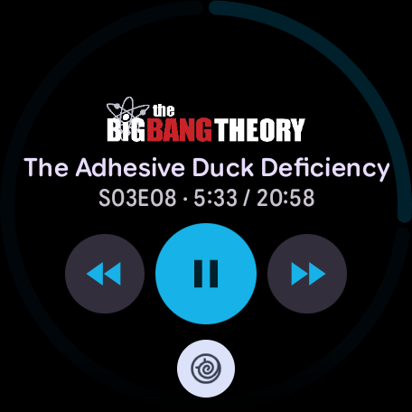

# Kodi Remote for Wear OS

Standalone Wear OS app (built for the Pixel Watch 3, 45mm; needs Wear OS 3 or later) that controls
Kodi over its HTTP JSON-RPC API.

Swipe between four pages:

1. **Now playing**: the show's or movie's logo (if the Kodi library has a clear logo), title,
   progress ring, seek back / play-pause / seek forward. The crown changes the volume.
2. **Remote**: D-pad with OK in the middle, a larger Back button, plus Home, Info and context menu.
3. **Volume**: turn the crown or use -/+, tap the middle button to mute.
4. **More**: previous, stop, next, and Settings (host, port, username, password).

<p>
  
  
  
  
</p>

On first launch the app opens Settings. **Save & test** saves the settings and checks the
connection; Settings closes once Kodi answers, otherwise it shows what went wrong.

The **Now playing** page is also available as a tile (long-press the watch face or swipe through
the tiles and add "Now playing"): logo or title, progress ring, seek back / play-pause / seek
forward. Tap the tile anywhere outside the buttons to open the app. The tile refreshes about once
a minute while something plays, and right away after a button press or when you leave the app.



## Kodi setup

Kodi → Settings → Services → Control:

- enable **Allow remote control via HTTP**
- note the port (default 8080) and set a username/password if you like

## Network

The watch talks to Kodi directly and needs to be on the **same Wi-Fi** as Kodi. The app asks
Wear OS to bring up Wi-Fi while it is open, because the default Bluetooth-via-phone connection
can't reach devices on your home network. The tile does the same for each refresh and keeps
Wi-Fi for about 20 seconds afterwards, so presses in a row are quick. The first connection can
take a few seconds while Wi-Fi turns on.

## Build and install

PowerShell:

```powershell
$env:JAVA_HOME = "C:\Program Files\Android\Android Studio\jbr"
.\gradlew assembleRelease
```

cmd:

```bat
set JAVA_HOME=C:\Program Files\Android\Android Studio\jbr
gradlew assembleRelease
```

To install on the watch: enable Developer options and **Wireless debugging** on the watch,
then pair and connect with `adb pair <ip:port>` / `adb connect <ip:port>` and run
`gradlew installRelease` (`.\gradlew installRelease` in PowerShell).

Use the release build for everyday use: the debug build is not shrunk and runs Compose in
debuggable mode, which makes swiping between pages noticeably laggy on the watch. The release
build is signed with the debug key, so it installs over a debug build and keeps the settings.
